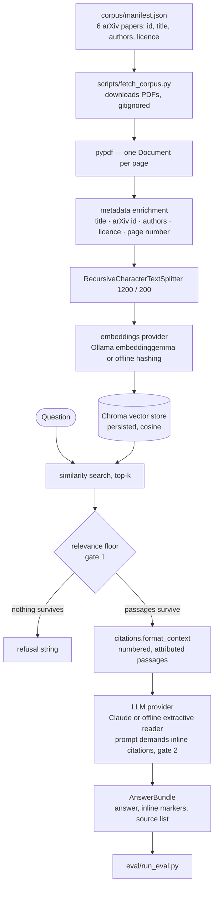

# RAG Document QA — Answers With Citations You Can Check


Ask a question about a library of research PDFs in plain English. Every answer carries an inline citation to the paper and page it came from — *"Attention Is All You Need (arXiv:1706.03762), page 3"*, never *"pdf1.pdf"*. When the documents do not contain the answer, the system says so instead of guessing.

The numbers are published rather than claimed. On a hand-built set of 20 questions: **100% retrieval accuracy, 100% refusal accuracy on the five deliberately unanswerable ones, 0 hallucinated answers and 0 fabricated citations.** The full scorecard — including the metric that does *not* flatter the system — is in [`eval/RESULTS.md`](eval/RESULTS.md) and below. **65 offline tests** and the whole harness run on a fresh clone with no credentials and no network.

Python 3.11 · LangChain · Chroma · pypdf · Ollama embeddings or offline hashing · Claude or offline extractive reader · pytest

> **One of three portfolio projects on applied AI for analytics.**
> [BigQuery SQL Agent](https://github.com/vk4868/bigquery-sql-agent) — natural language to guarded BigQuery SQL · [SQL Analyst Agent](https://github.com/vk4868/sql-analyst-agent) — a LangGraph agent over a read-only database, with tools served over MCP · **RAG Document QA** (this repo).

---

## Overview

A retrieval-augmented generation pipeline built around three design decisions:

- **Citations carried end to end.** Title, arXiv id and page are attached to every chunk at ingest, travel through retrieval into the prompt, and come back as inline `[n]` markers plus a source list.
- **An explicit refusal contract.** One configurable refusal string, enforced by a relevance floor before the model is called and by the prompt itself — refusal is a first-class outcome, not an accident.
- **An evaluation harness.** 20 hand-written questions, 5 deliberately unanswerable, scoring retrieval, correctness, citation validity and refusal accuracy with no credentials.

---

## Business problem

Organisations sit on document libraries nobody can search properly: policy manuals, regulatory guidance, contracts, research reports. Keyword search finds documents; it does not answer questions. Handing the documents to a chatbot answers questions, but introduces a worse problem — **the answer sounds authoritative and you cannot tell whether it is true.**

For anyone whose work is checked — an analyst writing a recommendation, a compliance officer citing a rule — an uncited answer is unusable. They cannot put it in front of a decision-maker without re-reading the source anyway, which removes the entire time saving.

Two failure modes make document chatbots unfit for that work:

1. **Unverifiable answers.** No source, no page, no way to check. The reader must take it on faith or redo the work.
2. **Hallucination.** Asked something the documents do not cover, a language model will often answer anyway, fluently and wrongly. This is the dangerous one, because nothing about the output looks wrong.

This project targets both, and — the part that matters — **measures whether it actually fixed them** rather than asserting it.

---

## What it produces

> **On the outputs below.** These are real, unedited terminal output from the offline providers, which quote retrieved sentences verbatim rather than paraphrasing (the answer paragraph is line-wrapped for width). A production model produces the same citation structure in more fluent prose; that run has not been captured here.

```
$ python -m rag.query "What is the difference between the RAG-Sequence and RAG-Token models?" --k 3

2.1 Models: RAG-Sequence and RAG-Token We propose two models that marginalise over the
latent retrieved documents in different ways. In the RAG-Token model we can draw a
different latent document for each target token and marginalize accordingly. [1] We
explore a general-purpose fine-tuning recipe for retrieval-augmented generation (RAG) -
models which combine pre-trained parametric and non-parametric memory for language
generation. We compare two RAG formulations, one which conditions on the same retrieved
passages across the whole generated sequence, the other can use different passages per
token. [3]

Sources:
  [1] Retrieval-Augmented Generation for Knowledge-Intensive NLP Tasks (arXiv:2005.11401), page 2 - https://arxiv.org/abs/2005.11401
  [2] BERT: Pre-training of Deep Bidirectional Transformers for Language Understanding (arXiv:1810.04805), page 2 - https://arxiv.org/abs/1810.04805   (retrieved, not cited)
  [3] Retrieval-Augmented Generation for Knowledge-Intensive NLP Tasks (arXiv:2005.11401), page 1 - https://arxiv.org/abs/2005.11401
```

Note the third source: retrieved but not used, and labelled as such rather than quietly presented as evidence. A question the corpus cannot answer gets the refusal string instead of a guess:

```
$ python -m rag.query "What revenue did Woolworths Group report in FY2024?"

I could not find an answer to that in the indexed documents.
```

`--json` returns the same result machine-readably — `question`, `answer`, `refused`, `cited` and a `sources` array carrying title, arXiv id, page, URL and a `cited` flag per source.

---

## Evaluation

The claim this project backs is *"evaluated against a hand-built test set to catch hallucinated answers"*. Here is what that means concretely.

`eval/testset.json` holds 20 questions written by hand after reading the papers: **15 in-corpus**, each with a gold answer, the arXiv id of the paper containing it and the facts the answer must contain; and **5 out-of-corpus**, whose only correct behaviour is the refusal string — the anti-hallucination set.

Four metrics are scored separately, because one blended number would hide which stage failed: retrieval accuracy (which caps everything downstream), answer correctness by deterministic keyword containment rather than an LLM judge (so scores never drift), citation rate, and refusal accuracy.

### Results

Measured 2026-08-10, offline providers, top-k = 5:

| Metric | Score | What it measures |
|---|---|---|
| **Retrieval accuracy** | **100.0%**  (15/15) | Metadata propagation and vector search |
| **Citation rate** | **86.7%**  (13/15) | The citation contract |
| **Refusal accuracy** | **100.0%**  (5/5) | The anti-hallucination gate |
| Hallucinated answers | **0** | No out-of-corpus question was answered |
| Fabricated citations | **0** | No marker pointed outside the retrieved set |
| False refusals | 2 | Q13, Q14 |
| *Extractive-reader answer floor* | *60.0%  (9/15)* | **Not a system quality score** — see below |

**On that last row.** It is deliberately not labelled "answer correctness", because it does not measure how well this system answers questions. It is the score of the *offline extractive reader*, a deterministic component that can only copy sentences from retrieved passages and cannot paraphrase — four of the six misses are that limitation exactly. It is reported as a **floor**: the number any reviewer can reproduce with zero credentials, and one a real language model should exceed. The same harness run against Claude and `embeddinggemma` would be expected to score considerably higher; **that run has not been performed, so no claim is made about it.**

### What the harness caught: Q18

One out-of-corpus question is deliberately adversarial — dense with machine-learning vocabulary the corpus does contain, asking about something it does not. The refusal gate originally used plain term overlap, and it answered Q18: fluently, with a correct-looking citation, from a real passage about the Adam optimiser in the LoRA paper. Nothing about the output looked wrong.

The fix was to weight each question term by its inverse document frequency across the retrieved passages, so terms appearing in *no* passage (`ImageNet`, `optimiser`, `schedule`) count as evidence that the question is unanswerable, while ubiquitous terms (`training`, `model`) count for little. Hallucinations went from 1 to 0.

That is the case for the harness in one example: **the bug was invisible from reading output, and only a known-unanswerable question exposed it.**

Full per-question table, failure analysis, the threshold sweep and the limitations are in **[`eval/RESULTS.md`](eval/RESULTS.md)**.

---

## How it works



**Ingest** stamps every page with title, arXiv id, authors, licence and page number *before* chunking — once a page is split, there is no recovering which paper it came from. **Query** embeds the question, retrieves the top-k chunks, filters them by the relevance floor, formats the survivors into numbered attributed passages, and instructs the model to cite inline and refuse if they do not cover the question. Markers are then parsed back out and matched to sources.

### The provider abstraction

Embeddings and generation each sit behind a small interface with two implementations, switched by two environment variables. Nothing else in the codebase branches on which provider is active.

- **Embeddings** — `BatchedOllamaEmbeddings` (local Ollama running `embeddinggemma`, batched under request-size limits), or `HashingEmbeddings` (hashed bag-of-words, sublinear weighting, L2-normalised, lightly stemmed).
- **Generation** — `ChatAnthropic` (a Claude model), or `OfflineExtractiveLLM` (quotes retrieved sentences, cites them, refuses when coverage is too low).

Calling Ollama and Anthropic directly would be simpler, but that version cannot be run by anyone without a GPU-backed embedding server and a paid API key — so it cannot be tested in CI, evaluated by a reviewer, or verified by a hiring manager reading this page. A deterministic implementation behind the same interface means the full pipeline, the test suite and the whole harness run on a fresh clone with zero credentials and produce byte-identical results. The cost is that the offline reader cannot paraphrase, which is exactly what the floor metric reports.

The rest of the stack is chosen for local-first reproducibility: LangChain's standard `Embeddings` / `BaseChatModel` interfaces make the provider swap clean, Chroma persists to disk with no server, `pypdf` gives reliable one-based page numbers (the unit a citation needs), and every setting comes from the environment or `.env`.

### The corpus

Six open-access, widely-cited machine-learning papers — *Attention Is All You Need*, *BERT*, *GPT-3*, *RAG*, *LoRA* and *Chain-of-Thought Prompting*.

**The PDFs are not committed.** They carry a mix of licences (five arXiv perpetual non-exclusive 1.0, one CC BY 4.0), so the repo ships pointers and a downloader rather than redistributing files. Copyright remains with the authors; each paper's licence is recorded in `corpus/manifest.json` and was checked against its arXiv abstract page.

---

## Installation and setup

Requires Python 3.11+.

```bash
git clone https://github.com/vk4868/rag-document-qa.git
cd rag-document-qa

python -m venv .venv
source .venv/bin/activate          # Windows: .venv\Scripts\activate

pip install -r requirements.txt
pip install -r requirements-dev.txt   # only to run the tests
```

**Option A — offline, no credentials (the default).** Nothing to configure, and fully functional:

```bash
python scripts/fetch_corpus.py     # downloads the 6 arXiv PDFs
python -m rag.ingest               # builds the vector index
python -m rag.query "What is scaled dot-product attention?"
```

**Option B — production providers.** Copy `.env.example` to `.env`, then:

- *Embeddings via Ollama* — install from <https://ollama.com/download>, run `ollama serve`, `ollama pull embeddinggemma`, set `RAG_EMBEDDING_PROVIDER=ollama`. The server must be running at ingest *and* query time, and the index must be rebuilt (`--rebuild`) when the provider changes, because vectors from different models are not comparable.
- *Generation via Anthropic* — set `ANTHROPIC_API_KEY` and `RAG_LLM_PROVIDER=anthropic`, optionally `RAG_LLM_MODEL`. Model ids are versioned and get superseded, so none is hardcoded.

---

## Usage

```bash
python -m rag.query "How many parameters does BERT-LARGE have?"
python -m rag.query "What is LoRA?" --k 8 --show-context     # show what was retrieved
python -m rag.query "What is chain-of-thought prompting?" --json
python -m rag.query "What is RAG-Token?" --min-relevance 0.2  # similarity floor

python -m rag.ingest --rebuild --chunk-size 1500 --chunk-overlap 250

python eval/run_eval.py
python eval/run_eval.py --json results.json --fail-under 55   # for CI
```

A missing index, missing PDFs, an absent API key and an unreachable Ollama server each produce an error naming the command that fixes it.

---

## Testing

```bash
pytest
```

```
65 passed
```

The suite runs with **no API key, no Ollama server and no network access**: `conftest.py` forces the deterministic providers before any configuration is imported, and the corpus tests read only `corpus/manifest.json`, so CI needs none of the PDFs. GitHub Actions runs it on every push and pull request.

Asserted across four files: sources render as title + arXiv id + page and never a filename, and fabricated markers are detected; the manifest validates and carries a licence per paper, no PDFs are committed, and metadata survives chunking; hashing embeddings are deterministic and L2-normalised, and the offline reader refuses below the coverage threshold; and retrieval, the relevance floor, the refusal path and the scoring functions run end to end.

---

## Skills demonstrated

**Business analysis** — starting from why an uncited answer is unusable to someone whose work is checked; defining the refusal contract as a product decision with a stated trade-off; separating what was measured from what was not.

**Data quality and governance** — a licence recorded per source document and verified against the publisher's page; sources fetched by manifest rather than redistributed; no binaries or secrets in version control; metadata attached before chunking so provenance cannot be silently lost.

**SQL and analytics** — a metric suite that isolates which stage failed rather than blending one number; a hand-built labelled test set including negative cases; a precision/recall trade-off quantified with a threshold sweep.

**Stakeholder communication** — every answer traceable to a page the reader can open; retrieved-but-unused sources labelled rather than presented as evidence; an unflattering number reported with its explanation.

**AI / ML engineering** — RAG pipeline design, vector search, chunking strategy, prompt design with an enforced output contract, and hallucination mitigation through retrieval gating.

**Software engineering** — a `src/` layout, dependency inversion behind provider interfaces, credential-free deterministic test doubles, 65 tests wired into CI, and pinned dependencies.

---

## Known limitations and what's next

- **The published numbers use the offline providers.** No production-provider run has been measured, and the extractive-reader floor understates what a real model would score. Running and publishing that evaluation is the most valuable next step.
- **The test set is small (20 questions) with no held-out split**, so the refusal threshold was fitted on the same questions it is scored against and refusal accuracy is optimistic. The fix is 100+ questions with a proper train/test split.
- **Correctness is keyword containment.** It can reward a right token in a wrong sentence and punish a correct paraphrase — the accepted cost of deterministic scoring, and the reason a semantic judge is queued alongside it rather than as a replacement.
- **Retrieval is flat top-k similarity**, and the lexical offline retriever cannot connect "corpora" to "corpus" (Q08). Hybrid retrieval — BM25 plus vector with reciprocal rank fusion, then a cross-encoder reranker — is the direct answer, and Q08 is the argument for it.
- **Citations are page-level, text-layer PDFs only.** Scanned documents need OCR (ingest raises a clear error rather than indexing nothing) and tables become linearised text. Sentence-level citation means tracking character offsets through chunking.

---

## Licence

Project code: MIT — see [LICENSE](LICENSE).

The corpus papers are **not** covered by that licence. Each remains the copyright of its authors under the licence recorded in `corpus/manifest.json`. No paper is redistributed by this repository.

---

## Author

**Vineet Kumar** — Melbourne, Australia.

Master of Business Analytics (Specialisation in Artificial Intelligence), Deakin University, July 2026. Previously Technical Analyst at Country Delight, analysing operational sensor data from across India in SQL, Excel and Tableau, mapping business workflows and writing BRDs with cross-functional teams. Australian work rights (Temporary Graduate visa, subclass 485).

Open to Business Analyst, Data Analyst, AI Analyst, AI Automation Analyst and Analytics Consultant roles.

- LinkedIn — <https://www.linkedin.com/in/vineetkumar->
- [BigQuery SQL Agent](https://github.com/vk4868/bigquery-sql-agent) — natural language to guarded BigQuery SQL
- [SQL Analyst Agent](https://github.com/vk4868/sql-analyst-agent) — a LangGraph agent over a read-only database
- [RAG Document QA](https://github.com/vk4868/rag-document-qa) — cited answers over a PDF corpus
